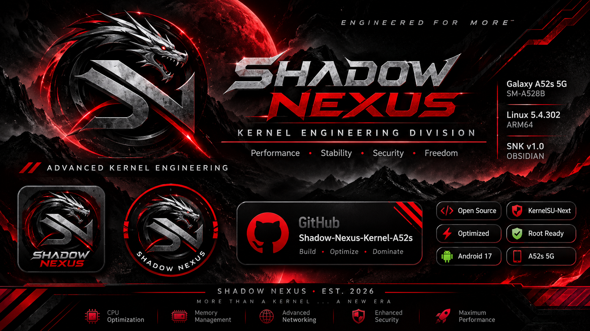



# Shadow Nexus Kernel

**SNK v1.0 · الاسم الكودي OBSIDIAN · من Shadow Engineering**

**كيرنال لينكس 5.4 جاهز لـ KernelSU-Next لموبايل Samsung Galaxy A52s 5G (`a52sxq`)**
مع Zygisk Next + Vector شغالين، وشبكة BBR/CAKE، وأدوات TTL/HL، وزيب يتفلّش من الريكفري.

[English](README.md) · [العربية](README.ar.md)

---

## الهوية

| | |
|---|---|
| العلامة | SHADOW NEXUS |
| الكيرنال | Shadow Nexus Kernel (SNK v1.0، الاسم الكودي OBSIDIAN) |
| المطوّر | Shadow Engineering |
| الريبو | `shadow-nexus-kernel-a52s` |
| الزيب | `ShadowNexus-A528B-v1.0.zip` |

شعارات البانر دعاية مش قياسات: شوف جدول الحالة تحت لمعرفة اللي اتأكد فعلاً. اسم إصدار الكيرنال (`uname -r`) **ماتغيّرش عمداً**: موديولات الفيندور بتتحقق منه (vermagic) وهترفض تتحمّل لو اتغيّر.

## ده إيه؟

Shadow Nexus Kernel عبارة عن وصفة بناء + باتشات + CI workflow (مش نسخة كاملة من سورس الكيرنال) بتطلّع كيرنال قابل للتفليش لجهاز **Galaxy A52s 5G (SM-A528B)** على روم مبني على LineageOS.

المشكلة الأساسية اللي بيحلها: مع الطريقة المعتادة في KernelSU-Next (**kprobes**) تشغيل الموديولات في مرحلة البوت ماكانش بيشتغل على الجهاز ده، فـ Zygisk Next و Vector (Xposed) مكانوش بيشتغلوا بعد الريبوت. البناء بـ **manual hooks** حلّ المشكلة.

## المميزات

| الميزة | الفايدة |
|---|---|
| KernelSU-Next (فرع legacy) بـ **manual hooks** | الروت شغال، الموديولات بتشتغل في البوت، و Zygisk Next و Vector بيبدأوا لوحدهم |
| BBR + fq_codel (اختياري) | سلوك أحسن لـ TCP على الواي فاي والداتا |
| CAKE qdisc | إدارة طوابير ذكية للتثبيت (tethering) وتقليل bufferbloat |
| أهداف `TTL` / `HL` في iptables | تغيير TTL/hop-limit للـ tethering |
| خيار Samsung USB VID/PID | استبدال معرّفات Google العامة بمعرّفات سامسونج وقت ربط الـ UDC |
| ABI guard | الـ CI يرفض أي بناء بتتغير فيه CRC للـ symbols المصدّرة عن baseline سليم (يحمي موديولات الفيندور) |
| موديول `shadownexus_tuning` | تظبيطات تشغيل اختيارية وآمنة (read-ahead وغيره) |
| مثبّت الريكفري | بيعيد تغليف الـ boot الحالي بتاعك، وبيعمل باك أب قبل الكتابة، وبيتحقق بعدها |

## الحالة: إيه اللي اتجرّب وإيه اللي لأ

| البند | الحالة |
|---|---|
| البوت + مدير KernelSU-Next | اتجرّب على جهاز واحد |
| Zygisk Next + Vector بعد ريبوت عادي | اتجرّب على جهاز واحد |
| BBR/CAKE/TTL/HL/USB VID-PID | اتجرّب على جهاز واحد |
| مثبّت الريكفري | اتجرّب على جهاز واحد |
| الـ workflow | اشتغل بنجاح على GitHub Actions، والبناء الناتج بيبوّت على الجهاز |
| ABI baseline + guard | الـ baseline متصدّر من بناء اتجرّب، وتشغيل تاني للـ CI عدّى بدون أي فرق (0 changed / 0 removed / 0 added) |
| موديول التيونينج | اتجرّب على جهاز واحد: read-ahead من 128 لـ 512 على `sda`-`sdf` بدون أخطاء. خيارات swappiness / VFS / zram فاضية افتراضياً و**ماتجرّبتش** |
| Multi-Gen LRU (خيار `mglru` الاختياري) | **تجريبي.** الباتش بيتطبق على السورس والملفات المتأثرة بتتكومبايل محلياً؛ **ماتفلّشش، ماتقاسش، وتأثيره على الـ ABI مجهول** |
| أجهزة / رومات / One UI تانية | **مش مدعومة ومش متجرّبة** |
| ادعاءات الأداء / البطارية | **مفيش. ماتقاسش.** |

## المدعوم

- الجهاز: Samsung Galaxy A52s 5G، `SM-A528B` / `a52sxq`
- الكيرنال: Linux `5.4.302` (سورس qgki / sm7325)
- الروم المجرّب: Infinity-X (مبني على LineageOS، أندرويد 17)، البوتلودر مفتوح

## التثبيت (مختصر)

1. **خد نسخة احتياطية من الـ boot الحالي** (المثبّت بيعمل برضو بس احتفظ بنسختك).
2. نزّل أحدث `ShadowNexus-A528B-*.zip` من Releases/Actions.
3. ادخل ريكفري مخصص، فلّش الزيب، وأعمل ريبوت.

التفاصيل: [docs/INSTALL.md](docs/INSTALL.md).

## ابنيه بنفسك

اعمل Fork للريبو، وافتح **Actions ← Build Shadow Nexus Kernel (a52sxq) ← Run workflow**. التفاصيل: [docs/BUILDING.md](docs/BUILDING.md).

## التوثيق

- [إزاي بيشتغل](docs/HOW-IT-WORKS.md)
- [التثبيت والاسترجاع](docs/INSTALL.md)
- [البناء](docs/BUILDING.md)
- [حل المشاكل](docs/TROUBLESHOOTING.md)
- [ABI guard](docs/ABI-GUARD.md)
- [موديول التيونينج](docs/TUNING-MODULE.md)
- [سجل التغييرات](CHANGELOG.md)

## قيود معروفة

- **IFB مقفول عمداً**: بيغيّر `struct sk_buff` وبيكسر موديولات الفيندور الجاهزة (بوتلوب).
- **البوتلودر يفضل مفتوح**؛ نتايج Play Integrity القوية وبعض الألعاب ذات الحماية الصارمة مش هتعدّي. المشروع ده مش بيساعد في تخطي الـ attestation أو الـ anti-cheat.
- بت Knox اتحرق بفتح البوتلودر ومينفعش يرجع.
- تفليش كيرنال ممكن يعمل بوتلوب أو يبوّظ الجهاز. المسؤولية عليك.

## الشكر والتراخيص

- Linux kernel: GPL-2.0
- سورس الكيرنال: LineageOS وصيّانو شجرة sm7325 (anhdat1024) كـ upstream، مش معاد توزيعه هنا
- [KernelSU-Next](https://github.com/KernelSU-Next/KernelSU-Next): GPL-2.0، بيتحمّل وقت البناء
- أدوات AnyKernel3 و magiskboot و busybox: بينارى ستاتيك مرفقة للمثبّت بتراخيصها
- Proton clang: بيتحمّل وقت البناء
- Multi-Gen LRU (اختياري): مأخوذ من شجرة [ghost_kernel_a52s_5g](https://github.com/Astreele/ghost_kernel_a52s_5g) (GPL-2.0)، والـ MGLRU نفسه من Yu Zhao ومساهمي لينكس
- CrappyKernel: مرجع لتجربة التفليش فقط

ملفات الريبو نفسها (باتشات، سكريبتات، workflow، توثيق) تحت **GPL-2.0**. اللوجو والبانر تصميم أصلي للمشروع.

## إخلاء مسؤولية

بدون أي ضمان. المشروع غير تابع لسامسونج ولا LineageOS ولا فريق KernelSU-Next.

