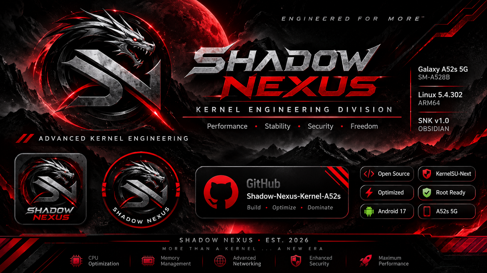

# BOSSMIDO KERNEL

**A KernelSU-Next ready Linux 5.4 kernel for the Samsung Galaxy A52s 5G (`a52sxq`)**
with working Zygisk Next + Vector, BBR/CAKE networking, TTL/HL tools and a recovery-flashable zip.

[English](README.md) · [العربية](README.ar.md)

---

## What is this?

BOSSMIDO KERNEL is a build recipe + patch set + CI workflow (not a fork of the whole kernel tree) that produces a flashable kernel for the **Galaxy A52s 5G (SM-A528B)** on a LineageOS-based ROM.

The main problem it solves: with the usual KernelSU-Next **kprobes** hooking, boot-stage module execution did not work on this device/kernel, so Zygisk Next and Vector (Xposed) never started after a reboot. Building with **manual hooks** fixed it.

## Highlights

| Feature | What you get |
|---|---|
| KernelSU-Next (legacy branch), **manual hooks** | Root manager works; modules run at boot; Zygisk Next daemon and Vector start automatically |
| BBR + fq_codel (optional tweak) | Better TCP behaviour on Wi-Fi / mobile data |
| CAKE qdisc | Smart queue management for tethering / bufferbloat |
| `TTL` / `HL` iptables targets | Change TTL/hop-limit for tethering |
| Samsung USB VID/PID option | Replaces the generic Google ADB IDs with Samsung's at UDC bind (MTP/ADB friendlier on PCs) |
| ABI guard | CI refuses a build whose exported symbol CRCs differ from a known-good baseline (protects vendor modules) |
| `bossmido_tuning` module | Optional, safe, best-effort runtime tuning (read-ahead etc.) |
| Recovery installer | Repacks your **existing** boot image, makes a backup first, verifies the write |

## Status: what is verified and what is not

| Item | Status |
|---|---|
| Boots, KernelSU-Next manager works | Verified on one device |
| Zygisk Next + Vector start after normal reboot | Verified on one device |
| BBR/CAKE/TTL/HL/USB VID-PID | Verified on one device |
| Recovery installer | Verified on one device |
| GitHub workflow | Ran successfully on GitHub Actions; the resulting build boots on the device |
| ABI baseline + guard | Baseline exported from a booted build; a second CI run passed with 0 changed / 0 removed / 0 added symbols |
| Tuning module | Verified on one device: read-ahead 128 -> 512 on `sda`-`sdf`, no errors. Swappiness / VFS pressure / zram options are empty by default and **untested** |
| Multi-Gen LRU (optional `mglru` input) | **Experimental.** Patch applies to the source tree and the touched files compile locally; **never booted, never benchmarked, ABI impact unknown** |
| Other devices / ROMs / One UI | **Not supported, not tested** |
| Performance / battery claims | **None made. Not measured.** |

## Supported

- Device: Samsung Galaxy A52s 5G, `SM-A528B` / `a52sxq`
- Kernel: Linux `5.4.302` (qgki / sm7325 source tree)
- ROM tested: Infinity-X (LineageOS-based, Android 17), bootloader unlocked

## Install (short version)

1. **Back up your current boot image** (the installer also does, but keep your own copy).
2. Download the latest `BOSSMIDO-KERNEL-*.zip` from Releases/Actions.
3. Reboot to custom recovery, flash the zip, reboot.

Details and recovery steps: [docs/INSTALL.md](docs/INSTALL.md).

## Build it yourself

Fork this repo, open **Actions -> Build BOSSMIDO KERNEL (a52sxq) -> Run workflow**. See [docs/BUILDING.md](docs/BUILDING.md).

## Documentation

- [How it works](docs/HOW-IT-WORKS.md): manual hooks, `path_umount`, VID/PID, why IFB is disabled
- [Install / restore](docs/INSTALL.md)
- [Building](docs/BUILDING.md)
- [Troubleshooting](docs/TROUBLESHOOTING.md)
- [ABI guard](docs/ABI-GUARD.md)
- [Tuning module](docs/TUNING-MODULE.md)
- [Changelog](CHANGELOG.md)

## Known limitations

- **IFB is intentionally not enabled**: it changes `struct sk_buff` and breaks prebuilt vendor modules (bootloop).
- **Bootloader stays unlocked**; Play Integrity strong/device verdicts and some games with strict anti-cheat will not pass. This project does not help with bypassing attestation or anti-cheat.
- Knox warranty bit is already tripped by unlocking and cannot be restored.
- Flashing a kernel can brick or bootloop a device. You do it at your own risk.

## Credits and licenses

- Linux kernel: GPL-2.0
- Kernel source tree: LineageOS and the `sm7325` tree maintainers (anhdat1024), used as upstream, not redistributed here
- [KernelSU-Next](https://github.com/KernelSU-Next/KernelSU-Next): GPL-2.0, fetched at build time
- AnyKernel3 tools, magiskboot, busybox: bundled static binaries used by the installer, under their own licenses
- Proton clang toolchain: fetched at build time
- Multi-Gen LRU backport (optional): taken from the GPL-2.0 [ghost_kernel_a52s_5g](https://github.com/Astreele/ghost_kernel_a52s_5g) tree (squashed commit `39289dde`); MGLRU itself is by Yu Zhao and the upstream Linux contributors
- CrappyKernel: used only as a reference for the recovery-flash experience

This repository's own files (patches, scripts, workflow, docs) are under **GPL-2.0** (see [LICENSE](LICENSE)). Logo and banner are original artwork for this project.

## Disclaimer

Provided as-is, with no warranty. Not affiliated with Samsung, LineageOS, or the KernelSU-Next project.
